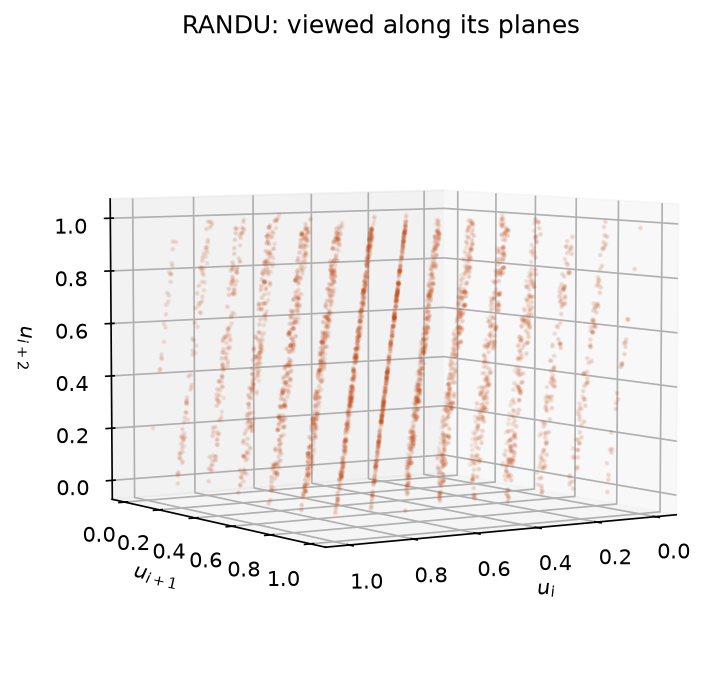
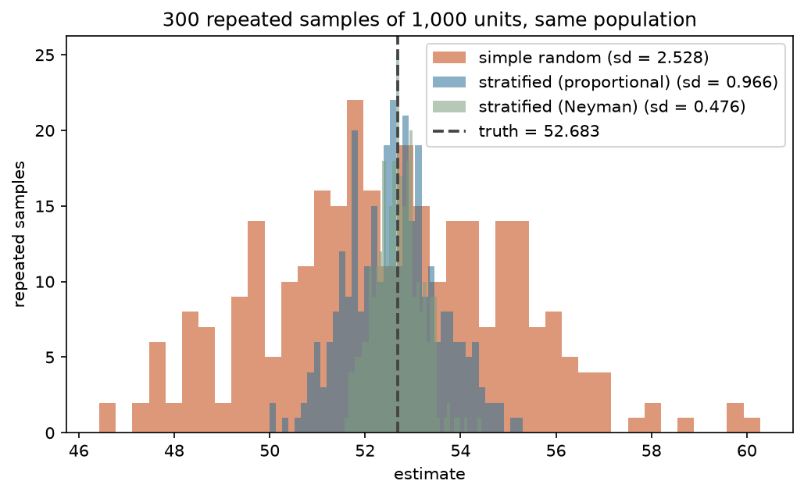

# Sampling 101

### Your random sample is not random, and it is costing you

A hands-on introduction to the deceptively hard problem of drawing data at random, built
from scratch on CPU. Six notebooks, a tested `src/` library, and a Streamlit app — all of it
running in under a minute on a 2-CPU Codespace with no GPU.

Every claim below is backed by a number this repository measures, against a ground truth it
knows exactly. Nothing here is asserted in prose and left unchecked.

---

## The pitch, in one figure

This is RANDU, a random number generator IBM shipped in the 1960s and that was used for a
decade of published science. It passes a chi-square uniformity test (p = 0.257). It has no
detectable serial correlation. Plot consecutive pairs and they fill the square.

Plot consecutive **triples** and look from the right angle:



Every single triple lies on one of exactly **15 planes**. All the "obvious" tests passed.

That is the theme: *random* is a property you verify, not one you assume — and the same
carelessness that lets a broken generator through is what makes a train-test split leak, a
survey converge confidently to the wrong number, and a risk estimate come back as zero.

---

## What this repository demonstrates

| Claim | Measured | |
|---|---|:--:|
| A broken generator passes a uniformity test | RANDU chi-square p = 0.257 | ✅ |
| …and fails a structure test | 100% of triples on 15 planes | ✅ |
| Inverse transform matches its target | KS p = 0.73 | ✅ |
| Rejection acceptance rate equals 1/m | 0.312 measured vs 0.313 theory | ✅ |
| Stratifying cuts variance at no extra cost | **6.9× lower** variance | ✅ |
| Neyman allocation does better still | **28.2× lower** variance | ✅ |
| Selection bias survives more data | converges to 66.09, truth is 52.68 | ✅ |
| Random row splits leak entities | 100% leaked vs 0% group-aware | ✅ |
| Monte Carlo error falls as n^−1/2 | fitted slope **−0.517** | ✅ |
| Brute force cannot see a 1-in-10⁷ event | 0 events in 1,000,000 draws | ✅ |
| Importance sampling recovers it cheaply | **+4.4% from 5,000 draws** | ✅ |
| A bad proposal is much worse | 27× more variable | ✅ |
| A light-tailed proposal fails at practical n | sd 0.020 vs 0.034 — it is *better* | ❌ |

That last row is a claim this project set out to demonstrate and **could not**. It is kept,
marked as unconfirmed, and explained in notebook 05. See
[Where the textbook is wrong](#where-the-textbook-is-wrong-at-practical-sample-sizes).

---

## Quickstart

```bash
make setup       # uv sync + register the Jupyter kernel
make test        # 69 tests, ~8s
make notebooks   # execute all six, ~46s total
make run         # Streamlit app on :8501
```

Requires Python 3.11+ and [uv](https://docs.astral.sh/uv/). No GPU, no CUDA, no torch.

---

## The notebooks

Read them in order — each one sets up the next.

| # | Notebook | What it shows |
|---|---|---|
| 01 | [What Random Really Means](notebooks/01_what_random_really_means.ipynb) | A broken generator passing every obvious test, then failing on the fourth |
| 02 | [Sampling From Any Distribution](notebooks/02_sampling_from_any_distribution.ipynb) | What `np.random.normal` is actually doing — inverse transform and rejection, from scratch |
| 03 | [When Your Sample Is Biased](notebooks/03_when_your_sample_is_biased.ipynb) | **Showpiece.** Stratifying beats simple random 6.9×; selection bias no sample size can fix |
| 04 | [Monte Carlo](notebooks/04_monte_carlo.ipynb) | **Showpiece.** Hard integrals become darts-and-count, at a measured n^−1/2 price |
| 05 | [Importance Sampling](notebooks/05_importance_sampling.ipynb) | **Payoff.** A one-in-ten-million probability recovered from 5,000 draws |
| 06 | [Practical Guide](notebooks/06_practical_guide.ipynb) | Decision guides, the scoreboard, and the tools you leave with |

Notebooks are committed **with outputs**, so they read on GitHub without running anything.

---

## Three things worth your time

### Unbiased is not the same as precise

Three designs, one population, 300 repeated samples of 1,000 units each. All three are
unbiased — every histogram sits on the truth. They differ only in how wildly they swing.



Stratifying is free. Same sample size, same cost, **6.9× less variance** — and Neyman
allocation, which spends the sample where the variance actually is, gets **28.2×**.

The corollary matters just as much: stratification removes *variance*, not *bias*. It is not
a repair for a broken sampling frame.

### More data cannot fix a biased frame

A survey where high-value units are merely twice as likely to answer — an unremarkable thing
to be true of a real survey. The estimator does not converge to the population mean of
**52.68**. It converges to **66.09**, a computable limit (`Σᵢ pᵢxᵢ`) that is simply the wrong
number. More responses tighten the confidence interval around it.

The failure is invisible from inside the sample. Nothing about the data looks wrong.

### A probability too small to sample

`P(X > 5.199)` for a standard normal is about **1 in 10 million**.

Brute force with a **million** draws returns an estimate of `0.0` with a standard error of
`0.0` — a confident, precise, wrong answer that an automated pipeline would report as zero
risk.

Importance sampling draws from a distribution where the event is common, reweights each draw
by `p(x)/q(x)`, and recovers the answer to **+4.4% from 5,000 draws** — 200× less work than
the attempt that failed outright.

---

## Where the textbook is wrong at practical sample sizes

Two findings here contradict what the standard treatment would lead you to expect. Both are
kept in the repository rather than tidied away.

**1. The classic warning does not bite.** Textbooks warn that a proposal with a *lighter tail*
than the target gives the importance weights infinite variance. True asymptotically. But
measured over 200 replicates at n = 5,000, `N(5.199, 0.25)` has a relative spread of **0.020**
against the good proposal's **0.034** — it performs *better*. The divergence lives far beyond
where 5,000 draws ever reach, so no diagnostic available at that sample size can see it.

The failure that *actually* bites is a proposal that leaves the event rare: `N(0, 1.5)` is
**27× more variable** and returns exactly zero in **25%** of runs.

**2. The usual ESS diagnostic reads backwards.** Effective sample size computed over the
weight vector gives **3.17** for the good proposal and **4,146 out of 5,000** for the bad one.
Follow it and you would throw away the proposal that works and ship the one that returns zero
a quarter of the time.

The reason is that the bad proposal is barely shifted, so its weights are all close to 1 and
look beautifully uniform, while the good proposal is shifted onto the tail and its weights
span orders of magnitude. Weight-ESS measures the wrong thing: draws outside the event
contribute exactly zero no matter how well behaved their weight is. Computed over the
*contributions* (`indicator × weights`) it reads **733 vs 2.0** — the right way round, and the
diagnostic that catches a failing proposal before the point estimate does.

---

## Reusable library

Everything demonstrated is tested library code, not notebook scratch.

```python
from src.draw.inverse_transform import numeric_inverse_cdf, sample_via_inverse_cdf
from src.survey.stratified import stratified_mean
from src.survey.grouped import group_train_test_split, group_leakage_rate
from src.montecarlo.importance import importance_estimate
from src.evaluation.convergence import fit_convergence_rate
```

| Module | What you get |
|---|---|
| `src/generators/` | An LCG with good and deliberately broken constants, plus the diagnostics that tell them apart |
| `src/draw/` | Inverse transform (analytic and numeric-grid), rejection sampling with an envelope check that raises, Vose alias tables |
| `src/survey/` | Simple / stratified (proportional and Neyman) / cluster designs, all returning standard errors; entity-safe splits; selection-bias demos |
| `src/montecarlo/` | Monte Carlo integration and expectations, importance sampling with weight diagnostics |
| `src/evaluation/` | Convergence-rate fitting, so you can measure your own error rate |
| `src/reporting.py` | Numpy-aware JSON persistence for results |
| `src/visualisation.py` | Every figure in this README |

Estimators return a value **and** a standard error. A point estimate with no uncertainty is
not an answer in this project.

---

## The Streamlit app

```bash
make run
```

Four interactive demonstrations: switch between the good and broken generators and watch the
output either fill the cube or collapse onto stripes; build a distribution sample by sample;
throw darts and watch π converge; and set an event rare enough that brute force fails, then
watch importance sampling recover it.

---

## Reproducibility

Every number and every figure comes from a seed recorded in
[`config/settings.yaml`](config/settings.yaml). Re-running any notebook reproduces them
exactly.

- The global `np.random` state is never touched. Every function taking randomness receives an
  explicit `np.random.Generator`.
- Notebooks write every visual to `outputs/figures/*.png` and every number and finding to
  `outputs/results/*.json`. Notebook 06 reads those files back, so its scoreboard quotes
  measured values rather than transcribed ones.
- Tests are seeded and deterministic. Statistical tolerances are derived from the standard
  error, with the derivation in a comment — never tuned until a flaky test passed.

```bash
make ci     # sync + lint (ruff, ty) + 69 tests
```

---

## Repository layout

```
config/settings.yaml   every sample size, seed and distribution parameter
notebooks/             01–06, committed with outputs
src/
  generators/          prng (LCG), quality (uniformity + lattice diagnostics)
  draw/                inverse_transform, rejection, discrete (alias method)
  survey/              simple, stratified, grouped, bias
  montecarlo/          integration, importance, variance
  datasets/            synthetic populations with known ground truth
  evaluation/          convergence-rate measurement
  reporting.py         results → JSON
  visualisation.py     figures → PNG
app/streamlit_app.py   four interactive demonstrations
tests/                 one file per claim
outputs/               figures/ (23 PNGs) and results/ (6 JSON files)
```

---

## Related projects

Sampling is the foundation these stand on:

- **bootstrap_101** — resampling your own data for a confidence interval
- **bayesian_101** — MCMC, i.e. sampling from a posterior you can only evaluate
- **ab_testing_lab** — simulation-based inference, which rests on correct sampling
- **causal_ml_101** — the same build-from-scratch "101" format

Not covered here, deliberately: MCMC, the bootstrap, quasi-Monte Carlo, variance reduction
beyond diagnostics, and reservoir sampling.

---

## References

- Metropolis, N. & Ulam, S. (1949). "The Monte Carlo Method." *JASA*.
- von Neumann, J. (1951). "Various Techniques Used in Connection with Random Digits."
  *NBS Applied Mathematics Series*. (Rejection sampling)
- Marsaglia, G. (1968). "Random Numbers Fall Mainly in the Planes." *PNAS*. (The RANDU result)
- L'Ecuyer, P. (1994). "Uniform Random Number Generation." *Annals of Operations Research*.
- Robert, C. & Casella, G. (2004). *Monte Carlo Statistical Methods* (2nd ed.). Springer.
- Owen, A. (2013). *Monte Carlo Theory, Methods and Examples*. (Importance sampling)
- Lohr, S. (2019). *Sampling: Design and Analysis* (3rd ed.). CRC Press.

## License

Apache-2.0. See [LICENSE](LICENSE).
